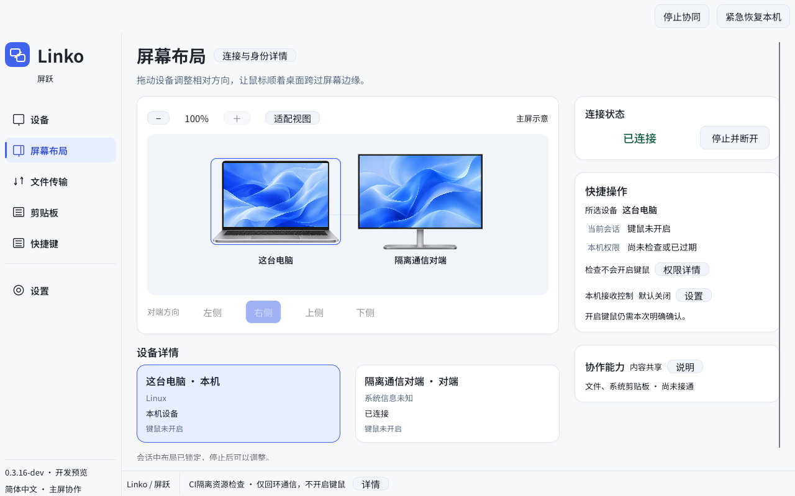

# Linko · 屏跃

一套键鼠，连接两台电脑的工作。

Linko 是使用 Rust 构建的局域网键鼠协作工具，面向 Windows 与 macOS。电脑各自运行应用、保留本地桌面，通过经过认证的连接协作。

**[官网](https://linko-63e.pages.dev/) · [下载开发预览](https://github.com/ForceMind/Linko/releases/tag/v0.3.22-dev) · [快速开始](docs/GETTING_STARTED.zh-CN.md) · [问题反馈](https://github.com/ForceMind/Linko/issues)**

> **0.3.22-dev 诊断预览**：真实 Windows ↔ macOS 双机键鼠验收尚未完成，暂不承诺日常主力使用。自动测试和通信探针不替代实机验收。



*0.3.20-dev 候选实际界面（8c6ecbb），隔离 NoNative 通信场景，未启用原生键鼠；公开诊断包为 0.3.22-dev。*

## 当前进度

同版 0.3.22 实测中，Windows 能控制 Mac，Mac 无法移动 Windows 光标。未发布的 0.3.23 候选包含 Mac 回程修复与连接中安全调整方向，已通过平台自动检查，仍待双机复测。新 V2 排版仍在后续范围。详见[功能与交付状态](docs/STATUS.zh-CN.md)。

## 当前能做什么

| 能力 | 状态 |
| --- | --- |
| 中文工作区、两台主屏相对方向 | 已实现；不是完整多显示器拓扑 |
| 短码核验、双端登记 | 已实现开发流程；记住设备不会自动允许控制 |
| Windows/macOS 键鼠捕获、转发、接收 | 原生实现和平台 CI 已有；真实双机兼容性待验收 |
| 停止、紧急恢复、输入归属清理 | 已实现及自动回归；物理恢复仍需实机验收 |
| 权限诊断、可选托盘／菜单栏 | 开发预览，实际程序权限分别检查 |
| 手势实验室、规则编辑 | 本窗口离线测试；全局 G1 尚未接通 |
| 剪贴板、文件 | 离线基础已实现；系统后端及生产网络尚未接通 |
| Linux | 通信与 GUI 诊断；没有原生键鼠后端 |

详细状态见[路线图](docs/ROADMAP.md)和[验证记录](docs/VALIDATION.md)。

## 下载与开始

在 [Releases](https://github.com/ForceMind/Linko/releases) 下载对应 ZIP 和 SHA-256 文件，无需 GitHub 账号。国内网络也可使用[官网备用下载](https://linko-63e.pages.dev/#preview)（gh-proxy.org 第三方代理，不保证所有网络可达或提速）；与 GitHub 原包一致，下载后仍需核对摘要。

| 平台 | 入口 | 发布状态 |
| --- | --- | --- |
| Windows x64 | 完整解压后打开 `Linko.exe` | 未代码签名的便携开发包 |
| macOS Apple 芯片 | 打开完整的 `Linko.app` | ad-hoc 完整性签名，尚未公证 |

1. 两台电脑进入同一局域网，分别运行同一版本。
2. 添加另一台电脑，核验短码，两端分别确认记住设备。
3. 设置对端所在方向，检查实际工作进程权限。
4. 两端分别决定接收控制，并明确开启本次键鼠协同。

校验命令、系统权限和排障见[快速开始](docs/GETTING_STARTED.zh-CN.md)。保留同包 worker，不关闭 Gatekeeper、UAC 或防火墙。

## 控制与恢复

松开按键和鼠标按钮后跨主屏边缘，键盘跟随目标。按住按钮不跨屏；原生文件跨屏拖放未提供。

- `Ctrl+Alt+Right` 并松开组合键：请求切换目标。
- `Ctrl+Alt+Esc`：请求紧急恢复。接收端首次物理动作只用于收回控制，不回放。
- 停止或退出后等待 worker 收尾。若提示“输入恢复未确认”，保留警告并检查两端，不反复开启新会话。

## 安全与隐私

设备登记、接收控制与本次开启分别处理；输入许可不包含数据或动作许可。应用不要求账号，不提供远程脚本或任意命令执行。诊断不记录真实按键、剪贴板、文件内容或私钥。漏洞见[安全政策](SECURITY.md)，设计见[安全模型](docs/SECURITY.md)。

## 从源码构建

GUI 最低 Rust **1.95**：

```sh
cargo build --release --workspace --locked
```

构建目标保留 `peerglide-gui` 和 `peerglide`，运行时放在一起。产品名为 Linko；已有数据目录、设备身份、macOS bundle identifier 和输入协议 v5 保持兼容。

## 文档与参与

[文档索引](docs/README.md) · [更新记录](CHANGELOG.md) · [贡献指南](CONTRIBUTING.md) · [支持](SUPPORT.md) · [发布规范](docs/RELEASING.md) · [架构](docs/ARCHITECTURE.md)

欢迎可复现的问题报告与范围清楚的 PR。真实设备结果与自动测试分别记录。

## 许可证

[MIT](LICENSE)。分发包附带依赖与字体许可声明，再分发应保留相应声明。
